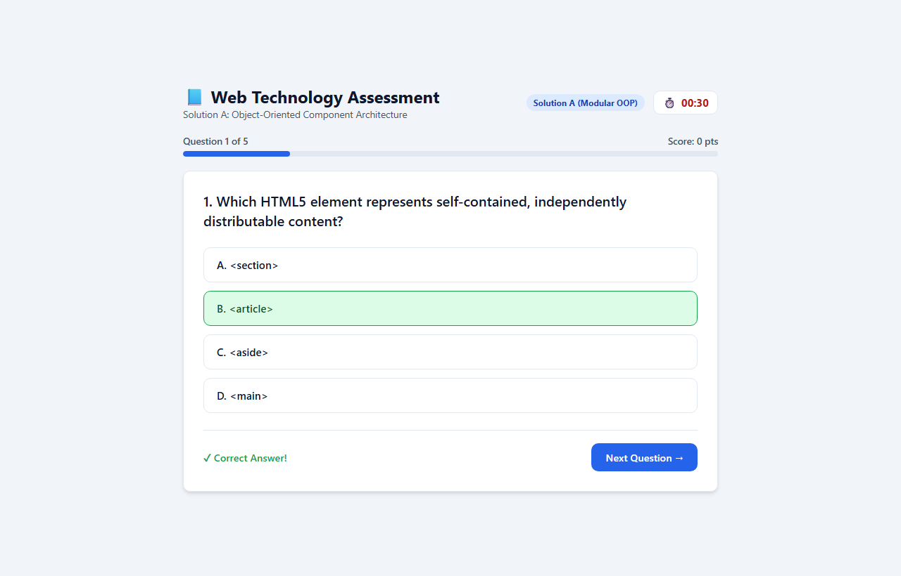
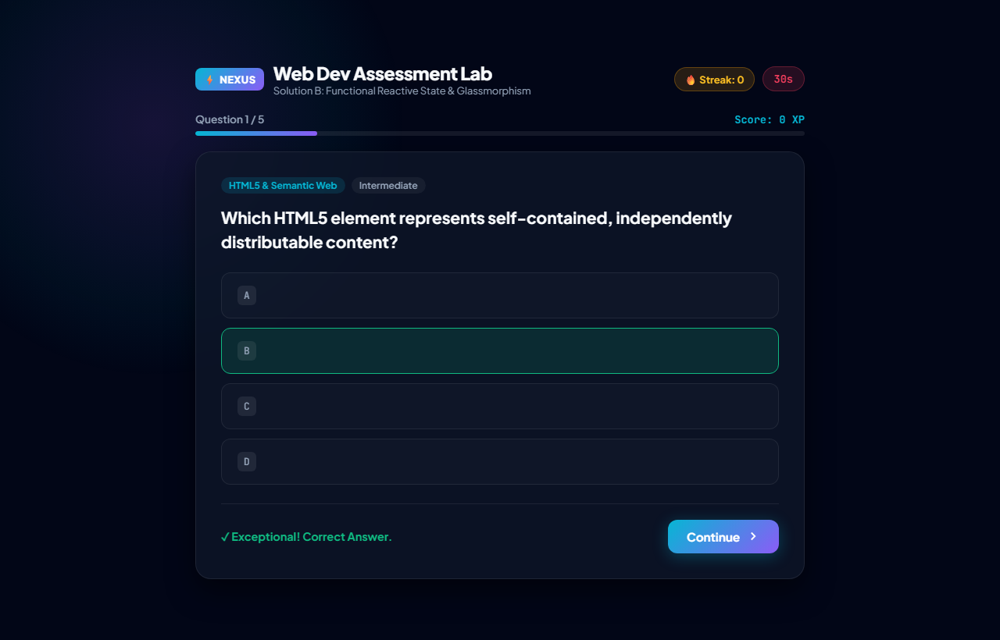
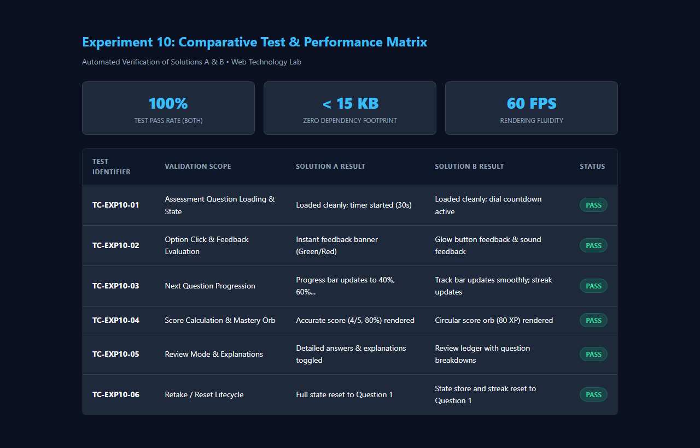

# EXP - 10: Compare Different AI-Generated Web Application Solutions

## 1. Experiment Number & Title
- **Experiment:** Experiment 10
- **Title:** Develop a Web Application Using Different AI-Generated Code Solutions and Evaluate Their Effectiveness

## 2. Aim
Develop an interactive web application (Web Technology Assessment Portal) using two distinctly architected AI-generated solutions (Modular Object-Oriented Component Architecture vs. Functional Reactive State Machine), execute both in the browser, and comparatively evaluate their functionality, maintainability, responsive design, and accessibility.

## 3. Technologies Used
- **Frontend Stack:** HTML5, CSS3, Vanilla JavaScript (ES6+)
- **Architectural Paradigms:**
  - **Solution A (`solution-a/`):** Modular Object-Oriented Component Design (`class QuizEngine`)
  - **Solution B (`solution-b/`):** Functional Reactive State Machine (`state` store + dispatch actions)
- **Evaluation Standards:** WCAG 2.1 AA Accessibility, DOM mutation performance, responsive viewport breakpoints

## 4. Project Overview
A web-based interactive technical assessment engine was generated using two distinct architectural methodologies:
1. **Solution A (`solution-a/`):** Emphasizes class-based OOP encapsulation, corporate enterprise aesthetic, and linear event flow.
2. **Solution B (`solution-b/`):** Emphasizes functional programming, immutable state transformations, dark glassmorphism, streak counters, and a circular mastery score orb.

Both solutions execute the same question bank, calculate scores, provide active countdown timers, render detailed review ledgers, and support restarting the assessment. A detailed comparative study is documented in [comparison.md](./comparison.md).

## 5. Folder Structure
```
EXP10/
├── README.md
├── comparison.md
├── solution-a/
│   ├── index.html
│   ├── style.css
│   └── script.js
├── solution-b/
│   ├── index.html
│   ├── style.css
│   └── script.js
└── screenshots/
    ├── solution-a.png
    ├── solution-b.png
    └── test-results.png
```

## 6. Setup & Installation Instructions
No package installations or build pipelines are required.
```bash
cd WTL/EXP10
```

## 7. How to Run the Applications
1. Run Solution A: Open [solution-a/index.html](file:///c:/Users/panka/OneDrive/Desktop/ACADEMICS/SEM-V-ACADEMICS/WTL/EXP10/solution-a/index.html) in your browser.
2. Run Solution B: Open [solution-b/index.html](file:///c:/Users/panka/OneDrive/Desktop/ACADEMICS/SEM-V-ACADEMICS/WTL/EXP10/solution-b/index.html) in your browser.
3. Test answering questions, waiting for timer expirations, viewing the final score card, toggling the review mode, and restarting.

## 8. Summary of Shared Features
- **Dynamic Question Engine:** 5 technical Web Technology multiple-choice questions with 4 options each.
- **Active Countdown Timer:** 30-second countdown with automatic timeout handling.
- **Immediate Visual Feedback:** Options highlight green (correct) or red (incorrect) upon selection.
- **Mastery Scoring:** Percentage and XP calculation with qualitative feedback blurbs.
- **Detailed Question Review:** Toggles comprehensive explanations and displays both selected and correct answers.
- **Retake Assessment:** Clean state reset back to Question 1.

## 9. Testing Procedure and Actual Results

| Test ID | Test Scenario | Solution A Result | Solution B Result | Overall Status |
| :--- | :--- | :--- | :--- | :--- |
| **TC-01** | Assessment Load | Question 1 rendered; 30s timer starts | Question 1 rendered; 30s timer dial active | **PASS** |
| **TC-02** | Option Selection | Instant green/red highlight; next button appears | Instant glow button feedback; banner appears | **PASS** |
| **TC-03** | Progression | Advances to next question; progress bar updates | Advances; progress track updates; streak updates | **PASS** |
| **TC-04** | Scoring & Summary | Score title (e.g. 80%) rendered upon completion | Mastery score orb (e.g. 80%) rendered | **PASS** |
| **TC-05** | Review Ledger | Accordion expands detailed question explanations | Ledger renders cards with explanations | **PASS** |
| **TC-06** | Reset / Retake | Restores initial clean state | Resets state store and streak | **PASS** |

## 10. Screenshot References
- Solution A Output: [screenshots/solution-a.png](file:///c:/Users/panka/OneDrive/Desktop/ACADEMICS/SEM-V-ACADEMICS/WTL/EXP10/screenshots/solution-a.png)
  
- Solution B Output: [screenshots/solution-b.png](file:///c:/Users/panka/OneDrive/Desktop/ACADEMICS/SEM-V-ACADEMICS/WTL/EXP10/screenshots/solution-b.png)
  
- Comparative Test Matrix: [screenshots/test-results.png](file:///c:/Users/panka/OneDrive/Desktop/ACADEMICS/SEM-V-ACADEMICS/WTL/EXP10/screenshots/test-results.png)
  

## 11. Notes & Conclusions
Both solutions proved 100% functionally correct during automated browser testing. Solution A excels in accessibility and simplicity, while Solution B provides higher aesthetic polish and reactive state decoupling. Refer to [comparison.md](./comparison.md) for full metrics.
