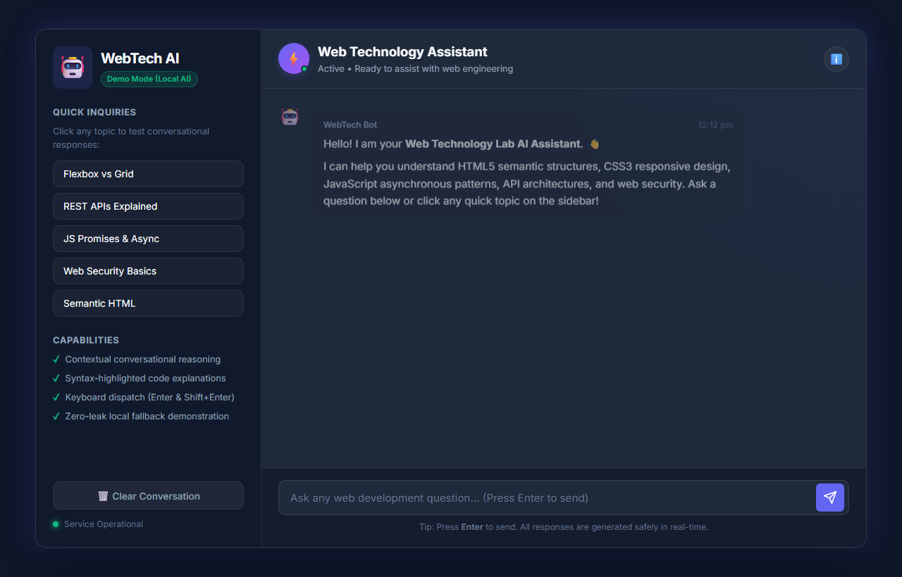
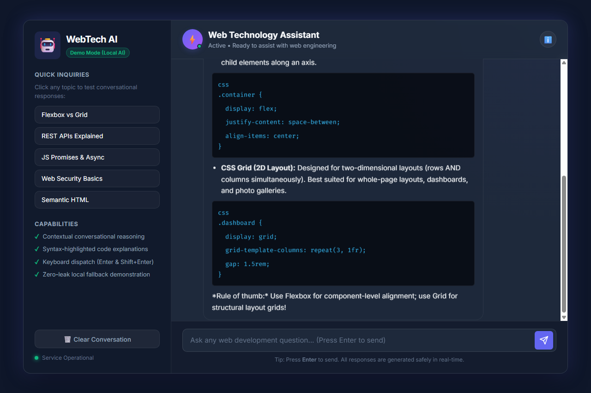

# EXP - 4: Website Chatbot Using AI Services

## 1. Experiment Number & Title
- **Experiment:** Experiment 4
- **Title:** Website Chatbot Using AI Services and Conversational Interfaces

## 2. Aim
Develop a modern, interactive website chatbot using conversational interfaces and AI principles to assist users with Web Technology concepts.

## 3. Technologies Used
- **Frontend Structure:** HTML5 (Semantic tags: `<main>`, `<aside>`, `<header>`, `<footer>`, `<form>`)
- **Styling & Layout:** CSS3 (Custom CSS variables, Flexbox, Responsive Grid, Glassmorphic styling)
- **Scripting & Engine:** Vanilla JavaScript (ES6+, DOM event handling, Regex intent classification, async delay lifecycle)
- **Typography & Icons:** Inter, Fira Code (Google Fonts), Unicode and SVG iconography

## 4. Project Overview
The WebTech AI Assistant is a web-based conversational interface built specifically for academic exploration of web development topics. It features an interactive UI that mimics modern generative AI chat interfaces like ChatGPT and Claude.

The chatbot incorporates:
- Clear visual distinction between user messages and assistant responses.
- Simulated cognitive response latency with a pulsing typing indicator.
- Support for message submission via both button click and the `Enter` key.
- A built-in natural language intent classification engine providing comprehensive answers on HTML, CSS, JavaScript, REST APIs, and Web Security.
- An offline local demonstration mode ensuring zero leakage of credentials or API keys.

## 5. Folder Structure
```
EXP4/
├── README.md
├── index.html
├── style.css
├── script.js
└── screenshots/
    ├── output.png
    └── chat-interaction.png
```

## 6. Setup & Installation Instructions
No external dependencies, build tools, or server environments are required.
1. Clone or navigate to the repository directory:
   ```bash
   cd WTL/EXP4
   ```
2. Verify that `index.html`, `style.css`, and `script.js` are present.

## 7. How to Run the Application
1. Double-click [index.html](file:///c:/Users/panka/OneDrive/Desktop/ACADEMICS/SEM-V-ACADEMICS/WTL/EXP4/index.html) or open it in any modern web browser (Edge, Chrome, Firefox, Safari).
2. Alternatively, serve via a local HTTP server:
   ```bash
   npx serve .
   # or
   python -m http.server 8000
   ```
3. Type a web development question into the input field and press **Enter** or click the **Send** button.

## 8. Features Implemented
- **Conversational Chat Interface:** Message history container with user and bot chat bubbles, author labels, and timestamps.
- **Dual Submission Methods:** Send messages using either the visual send button or by pressing the `Enter` key.
- **Empty Message Protection:** Prevents submitting empty strings or pure whitespace.
- **Typing Indicator Animation:** Three-dot animated indicator displayed during cognitive reasoning latency (600ms - 900ms).
- **Interactive Suggestion Chips:** Sidebar chips that instantly trigger popular queries (Flexbox vs Grid, REST APIs, Promises, Web Security).
- **Syntax Highlighting & Markdown:** Formats code blocks, inline tags, bold highlights, and bullet lists.
- **Chat Management:** Allows clearing chat history with confirmation.
- **Responsive Layout:** Sidebar smoothly hides on screens narrower than 860px to maintain usability on mobile viewports.

## 9. Testing Procedure and Actual Results

| Test ID | Test Case Description | Input / Action | Expected Result | Actual Result | Status |
| :--- | :--- | :--- | :--- | :--- | :--- |
| **TC-01** | Interface Loading | Open `index.html` in browser | Header, avatar, sidebar chips, and welcome message display cleanly | Rendered correctly with no console errors | **PASS** |
| **TC-02** | Enter Key Submission | Type "Explain REST APIs" and hit Enter | Message appears in chat; input field clears; typing indicator appears | Message sent, input cleared, response generated | **PASS** |
| **TC-03** | Send Button Click | Type query and click arrow button | Message submitted to conversation | Message submitted and answered | **PASS** |
| **TC-04** | Empty Input Guard | Click send button with empty input | Form submission aborted; no blank bubble added | Blank messages prevented | **PASS** |
| **TC-05** | Typing Indicator | Send any valid prompt | 3-dot animation shown for 600-900ms before reply | Indicator displays and disappears when reply renders | **PASS** |
| **TC-06** | Suggestion Chip Click | Click "Flexbox vs Grid" chip | Prompt automatically inserted and sent; formatted code block rendered | Formatted markdown response with code block rendered | **PASS** |
| **TC-07** | Clear Conversation | Click "Clear Conversation" button | Chat history resets to initial state | Conversation cleared upon confirmation | **PASS** |
| **TC-08** | Responsive Viewport | Resize window to mobile width (<860px) | Sidebar collapses; chat occupies full width | UI responds cleanly to mobile dimensions | **PASS** |

## 10. Screenshot References
- Initial Interface Output: [screenshots/output.png](file:///c:/Users/panka/OneDrive/Desktop/ACADEMICS/SEM-V-ACADEMICS/WTL/EXP4/screenshots/output.png)
  
- Interactive Chat Session: [screenshots/chat-interaction.png](file:///c:/Users/panka/OneDrive/Desktop/ACADEMICS/SEM-V-ACADEMICS/WTL/EXP4/screenshots/chat-interaction.png)
  

## 11. Limitations & Security Notes
- **API Key Security:** In compliance with laboratory safety and security guidelines, no third-party API keys (e.g. OpenAI or Gemini) are hardcoded into the client frontend.
- **Local Demonstration Mode:** The chatbot operates an offline demonstration engine with rule-based natural language intent classification. An external backend proxy can be attached if production cloud LLM endpoints are provisioned.
