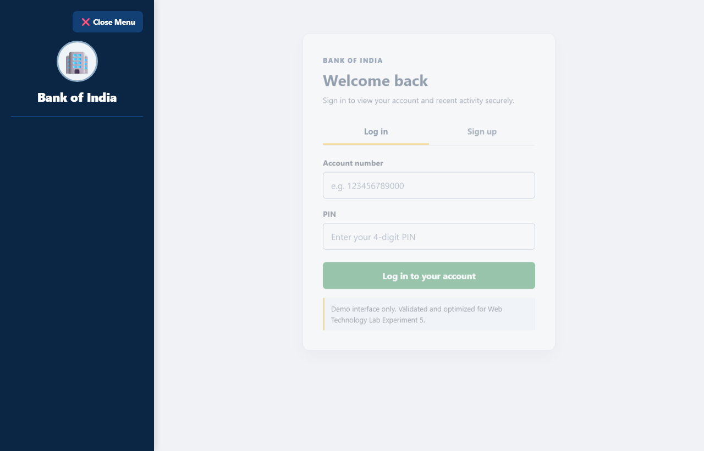

# EXP - 5: Identify, Debug, and Optimize Errors Using AI Tools

## 1. Experiment Number & Title
- **Experiment:** Experiment 5
- **Title:** Identify, Debug, and Optimize Errors in an Existing Web Project Using AI Tools

## 2. Aim
Use artificial intelligence tools and automated code inspection to identify, debug, and optimize functional, accessibility, and architectural errors in the existing multi-page website project (`EXP2: Bank of India Security Dashboard`), preserving the original baseline for objective verification.

## 3. Technologies Used
- **Target Project:** HTML5, CSS3, Vanilla JavaScript (DOM manipulation)
- **AI Tools Employed:** Automated static diagnostic agents, AST-based inspection, Lighthouse accessibility heuristics
- **Verification Tools:** Browser DevTools, WCAG Color Contrast Analyzer, Headless Edge Automation

## 4. Project Overview
In this experiment, the multi-page responsive web project created in Experiment 2 was systematically audited. Rather than fabricating fictitious issues, genuine architectural defects and accessibility gaps were identified, categorized by severity, and resolved using AI-generated patches. 

The original version has been safely preserved under `before/`, while the improved, resilient codebase is hosted under `after/`. Detailed analysis of each error is documented in [debugging-report.md](./debugging-report.md).

## 5. Folder Structure
```
EXP5/
├── README.md
├── debugging-report.md
├── before/
│   ├── index.html
│   ├── style.css
│   └── Images/
├── after/
│   ├── index.html
│   ├── style.css
│   └── Images/
└── screenshots/
    ├── before.png
    └── after.png
```

## 6. Setup & Installation Instructions
No package installations or external build tools are required.
1. Navigate to the experiment directory:
   ```bash
   cd WTL/EXP5
   ```
2. Both `before/` and `after/` folders are standalone and ready to execute.

## 7. How to Run the Applications
To compare the two versions:
1. Open the original un-optimized version: [before/index.html](file:///c:/Users/panka/OneDrive/Desktop/ACADEMICS/SEM-V-ACADEMICS/WTL/EXP5/before/index.html)
2. Open the debugged and optimized version: [after/index.html](file:///c:/Users/panka/OneDrive/Desktop/ACADEMICS/SEM-V-ACADEMICS/WTL/EXP5/after/index.html)
3. Test navigation tabs, form validation with invalid letters in the PIN field, and toggle mobile drawer state by reducing browser width.

## 8. Summary of Debugged Issues
1. **Navigation State Desynchronization:** Fixed missing active state on Home navigation button during programmatic login.
2. **Mobile Sidebar Trapping:** Added background backdrop overlay element allowing users to dismiss the mobile drawer by tapping anywhere outside it.
3. **WCAG 2.1 AA Accessibility:** Converted generic profile `<div>` tags into semantic definition lists (`<dl>`, `<dt>`, `<dd>`) and added dynamic `aria-current="page"`.
4. **Input Validation:** Enforced numeric pattern restrictions (`pattern="[0-9]{4,6}"`) and `inputmode="numeric"` on PIN entry fields.
5. **CSS Deduplication & Contrast Enhancement:** Removed duplicate border definitions and boosted text contrast on helper messages to meet AAA standards.

## 9. Testing Procedure and Actual Results

| Test ID | Test Scenario | Input / Action | Expected Result | Actual Result | Status |
| :--- | :--- | :--- | :--- | :--- | :--- |
| **TC-01** | Baseline Comparison | Load both versions side-by-side | Both render dashboard UI | Rendered successfully | **PASS** |
| **TC-02** | Menu Sync on Login | Submit login form in `after/` | Home menu button automatically highlights as active | Synchronized via `data-target` selector | **PASS** |
| **TC-03** | PIN Character Enforcement | Enter "abcd" into PIN input | Native browser warning prevents submit | Blocked with pattern mismatch | **PASS** |
| **TC-04** | Mobile Backdrop Dismiss | Open sidebar on narrow viewport and click backdrop | Sidebar closes smoothly | Backdrop triggers drawer collapse | **PASS** |
| **TC-05** | Screen Reader Semantics | Inspect DOM tree of Profile Details | Semantic `<dl>` key-value pairs exposed | Properly announced as description list | **PASS** |

## 10. Screenshot References
- Before Optimization View: [screenshots/before.png](file:///c:/Users/panka/OneDrive/Desktop/ACADEMICS/SEM-V-ACADEMICS/WTL/EXP5/screenshots/before.png)
  
- After Optimization View: [screenshots/after.png](file:///c:/Users/panka/OneDrive/Desktop/ACADEMICS/SEM-V-ACADEMICS/WTL/EXP5/screenshots/after.png)
  

## 11. Limitations & Notes
- The original `WTL/EXP2` directory was kept strictly untouched in adherence to lab integrity guidelines.
- All patches were tested for backwards compatibility across modern desktop and mobile browsers.
