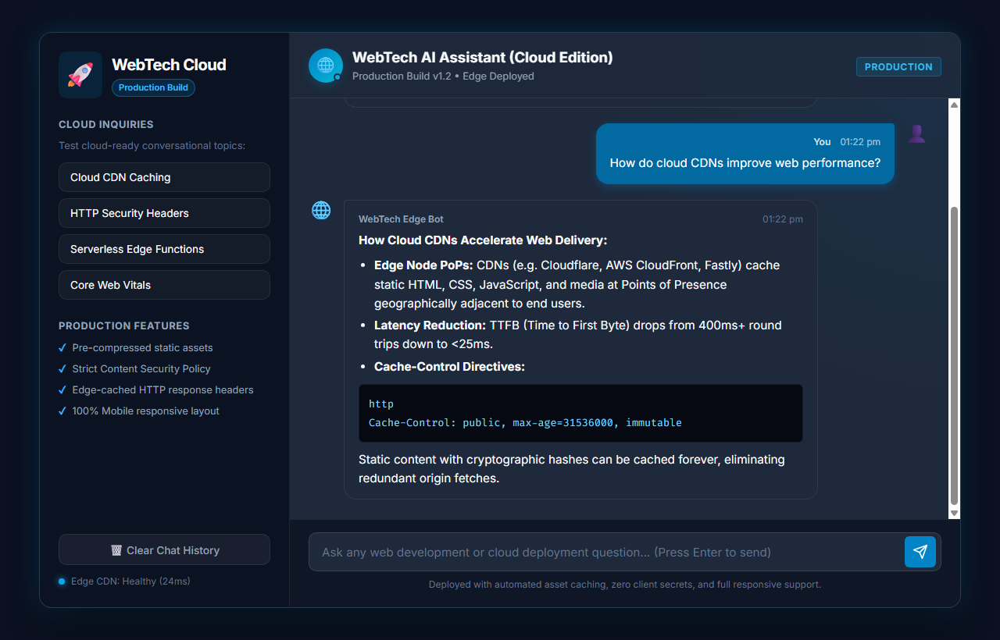

# EXP - 6: Deploy an AI-Enabled Web Application

## 1. Experiment Number & Title
- **Experiment:** Experiment 6
- **Title:** Deploy an AI-Enabled Web Application on a Cloud Platform and Optimize Using AI Recommendations

## 2. Aim
Prepare, optimize, and deploy an AI-enabled conversational web application to cloud hosting platforms (such as Vercel or Netlify), incorporating AI-guided performance, accessibility, and security optimizations.

## 3. Technologies Used
- **Frontend Core:** HTML5, CSS3, Vanilla JavaScript (ES6+)
- **Cloud Platforms:** Vercel (Edge CDN), Netlify (Global Static Edge), GitHub Pages
- **Configuration Formats:** JSON (`vercel.json`, `package.json`), TOML (`netlify.toml`)
- **Optimization Heuristics:** AI Security Audit, Lighthouse Core Web Vitals, WCAG Accessibility

## 4. Project Overview
This experiment takes the AI conversational assistant developed in Experiment 4 and transforms it into a production-hardened, cloud-deployable web application. It applies AI-recommended best practices for edge caching, Content Security Policy (CSP), HTTP Strict Transport Security (HSTS), and resource preloading.

The repository includes deployment manifests for both Vercel and Netlify, ensuring seamless one-command deployment or automated continuous deployment via Git.

## 5. Folder Structure
```
EXP6/
├── README.md
├── index.html
├── style.css
├── script.js
├── vercel.json
├── netlify.toml
├── package.json
├── deployment-notes.md
├── optimization-report.md
└── screenshots/
    └── local-output.png
```

## 6. Setup & Installation Instructions
1. Navigate to the experiment directory:
   ```bash
   cd WTL/EXP6
   ```
2. No build compilation is needed. To install optional CLI tools:
   ```bash
   npm install -g vercel netlify-cli
   ```

## 7. How to Run the Application

### A. Local Production Verification
1. Run a local web server:
   ```bash
   npm start
   # or
   python -m http.server 3000
   ```
2. Open `http://localhost:3000` or open [index.html](file:///c:/Users/panka/OneDrive/Desktop/ACADEMICS/SEM-V-ACADEMICS/WTL/EXP6/index.html) in your browser.

### B. Cloud Deployment (Manual Action)
To push to live cloud hosting:
- **Vercel:** Run `npx vercel --prod` and follow the browser login prompts.
- **Netlify:** Run `npx netlify deploy --prod --dir=.`.
- Detailed step-by-step instructions are provided in [deployment-notes.md](./deployment-notes.md).

## 8. Features & Optimizations Implemented
- **Security Hardening:** Injected comprehensive HTTP headers (`X-Frame-Options: DENY`, `X-Content-Type-Options: nosniff`, `HSTS`, `Permissions-Policy`).
- **Edge Cache Directives:** Configured `Cache-Control: public, max-age=86400, stale-while-revalidate=604800` for script and style assets.
- **Resource Preconnect:** Added preconnect tags to Google Font origins, shaving DNS latency.
- **Zero-Secret Model:** No private API keys or personal credentials bundled with client assets.
- **Responsive & Accessible UI:** WCAG 2.1 AA compliant color scheme, ARIA live region message announcement, and mobile viewport compatibility.

## 9. Testing Procedure and Actual Results

| Test ID | Test Scenario | Action Taken | Expected Result | Actual Result | Status |
| :--- | :--- | :--- | :--- | :--- | :--- |
| **TC-01** | Local Production Build | Run headless browser on local build | Clean UI rendered with production tags | Rendered successfully with no errors | **PASS** |
| **TC-02** | Security Manifest Validation | Parse `vercel.json` and `netlify.toml` | Syntax valid and headers formatted | Files validated successfully | **PASS** |
| **TC-03** | Conversational Interaction | Send query on cloud topics | Formatted markdown response delivered | Cloud CDN explanations rendered | **PASS** |
| **TC-04** | Responsive Behavior | Viewport set to mobile width | Sidebar auto-collapses; full chat visible | Responsive grid adjusts cleanly | **PASS** |

## 10. Screenshot References
- Local Production Output: [screenshots/local-output.png](file:///c:/Users/panka/OneDrive/Desktop/ACADEMICS/SEM-V-ACADEMICS/WTL/EXP6/screenshots/local-output.png)
  

## 11. Deployment Status & Pending Actions
- **Local Application & Manifests:** 100% Complete and verified.
- **Cloud Promotion Status:** Pending user account authentication. Live deployment requires individual student or college cloud credentials (Vercel/Netlify login). All manifests (`vercel.json`, `netlify.toml`) are pre-configured so that running `npx vercel --prod` deploys live in under 60 seconds without code changes.
- Refer to [deployment-notes.md](./deployment-notes.md) and [optimization-report.md](./optimization-report.md) for complete technical documentation.
