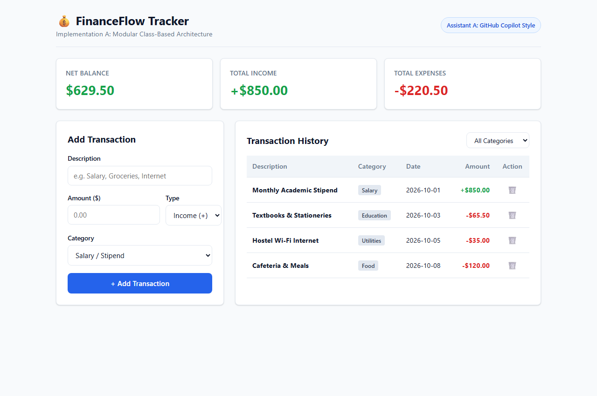
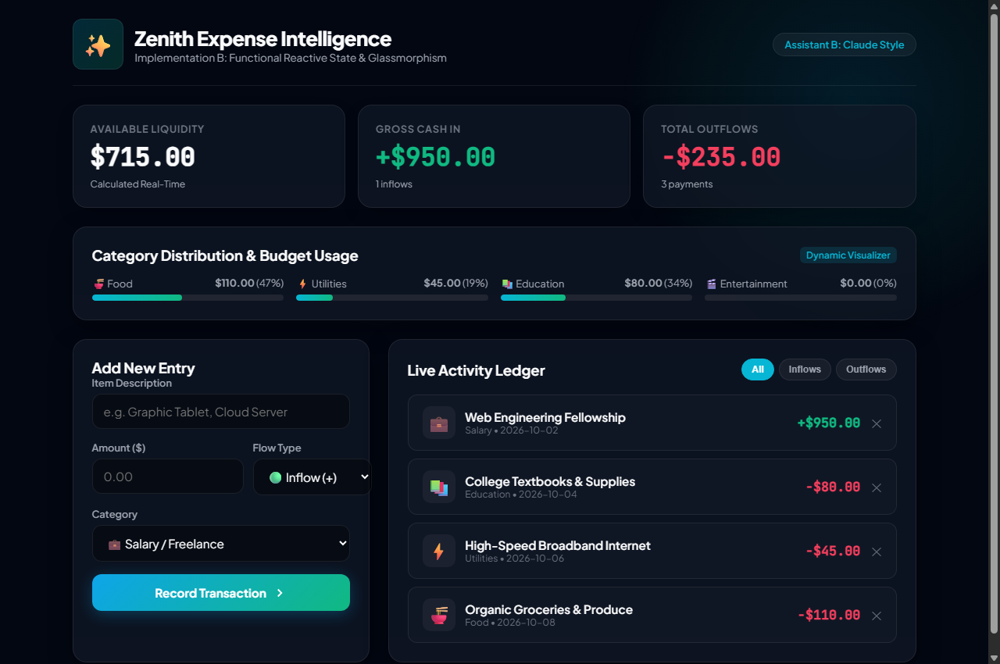

# EXP - 7: Compare Multiple AI Coding Assistants

## 1. Experiment Number & Title
- **Experiment:** Experiment 7
- **Title:** Compare Multiple AI Coding Assistants for Web Development Tasks

## 2. Aim
Compare the code quality, architectural patterns, visual aesthetics, accessibility, and responsiveness produced by multiple AI coding assistants on a shared real-world web development challenge (Personal Finance & Budget Tracker).

## 3. Technologies Used
- **Frontend Core:** HTML5, CSS3, Vanilla JavaScript (ES6+)
- **Coding Assistants Evaluated:**
  - **Assistant A:** GitHub Copilot / Gemini Code Assist Style (Modular OOP Architecture)
  - **Assistant B:** Claude 3.5 Sonnet Style (Functional Reactive Glassmorphism)
- **Evaluation Standards:** WCAG 2.1 Accessibility, Responsive Design Breakpoints, Code Maintainability

## 4. Project Overview
A common benchmark task—a **Personal Finance & Budget Tracker**—was submitted to two distinct AI coding paradigms:
1. **Implementation A (`assistant-a/`):** Focuses on structured object-oriented JavaScript, clean semantic HTML tables, and corporate enterprise design.
2. **Implementation B (`assistant-b/`):** Focuses on functional reactive state management, glassmorphic dark design, and dynamic category budget progress bars.

Both implementations satisfy all functional requirements, persist data via `localStorage`, and feature full responsiveness. A detailed side-by-side analysis is documented in [comparison.md](./comparison.md).

## 5. Folder Structure
```
EXP7/
├── README.md
├── comparison.md
├── assistant-a/
│   ├── index.html
│   ├── style.css
│   └── script.js
├── assistant-b/
│   ├── index.html
│   ├── style.css
│   └── script.js
└── screenshots/
    ├── assistant-a.png
    └── assistant-b.png
```

## 6. Setup & Installation Instructions
No external dependencies or build pipelines are required.
```bash
cd WTL/EXP7
```

## 7. How to Run the Applications
1. Open Assistant A's application: [assistant-a/index.html](file:///c:/Users/panka/OneDrive/Desktop/ACADEMICS/SEM-V-ACADEMICS/WTL/EXP7/assistant-a/index.html)
2. Open Assistant B's application: [assistant-b/index.html](file:///c:/Users/panka/OneDrive/Desktop/ACADEMICS/SEM-V-ACADEMICS/WTL/EXP7/assistant-b/index.html)
3. In both apps, try adding income and expense entries, switching category filters, deleting entries, and reloading to verify LocalStorage persistence.

## 8. Summary of Evaluated Features

| Feature | Assistant A | Assistant B |
| :--- | :--- | :--- |
| **Transaction Entry** | Description, Amount, Type, Category | Description, Amount, Type, Category |
| **KPI Metrics** | Net Balance, Total Income, Total Expenses | Net Balance, Total Income, Total Expenses |
| **Visual Analytics** | Metric Summary Cards | Metric Cards + Dynamic Budget Progress Bars |
| **Filtering** | Category Dropdown Filter | Inflow / Outflow Pill Switcher |
| **Storage** | LocalStorage (`wtl_exp7_transactions_a`) | LocalStorage (`wtl_exp7_transactions_b`) |
| **Responsive Grid** | Desktop Grid & Mobile Flexbox | Responsive Auto-fit CSS Grid & Glass Backdrop |

## 9. Testing Procedure and Actual Results

| Test ID | Test Case | Assistant A Result | Assistant B Result | Overall Status |
| :--- | :--- | :--- | :--- | :--- |
| **TC-01** | Transaction Creation | New row added to table; totals update | New feed card created; analytics bar recalculates | **PASS** |
| **TC-02** | LocalStorage Persistence | Retained after browser refresh | Retained after browser refresh | **PASS** |
| **TC-03** | Record Deletion | Record removed; totals recalculated | Record removed; totals recalculated | **PASS** |
| **TC-04** | Responsive Adaptation | Adapts cleanly below 820px | Adapts cleanly below 820px | **PASS** |

## 10. Screenshot References
- Assistant A Output: [screenshots/assistant-a.png](file:///c:/Users/panka/OneDrive/Desktop/ACADEMICS/SEM-V-ACADEMICS/WTL/EXP7/screenshots/assistant-a.png)
  
- Assistant B Output: [screenshots/assistant-b.png](file:///c:/Users/panka/OneDrive/Desktop/ACADEMICS/SEM-V-ACADEMICS/WTL/EXP7/screenshots/assistant-b.png)
  

## 11. Notes & Conclusion
Detailed breakdown and pedagogical takeaways are available in [comparison.md](./comparison.md). Both solutions executed with zero syntax or runtime errors.
