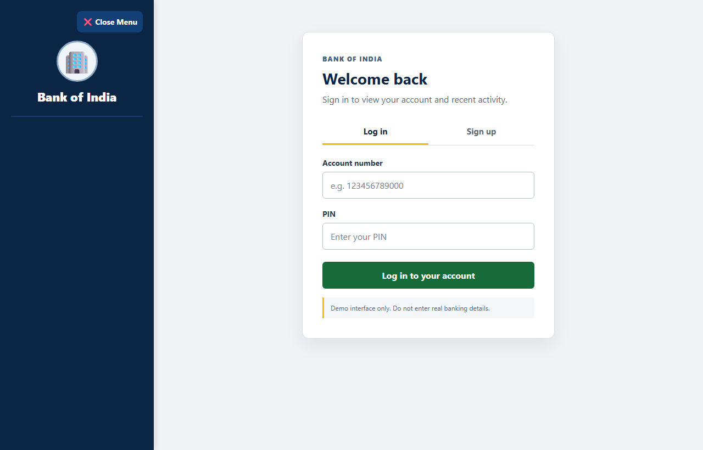
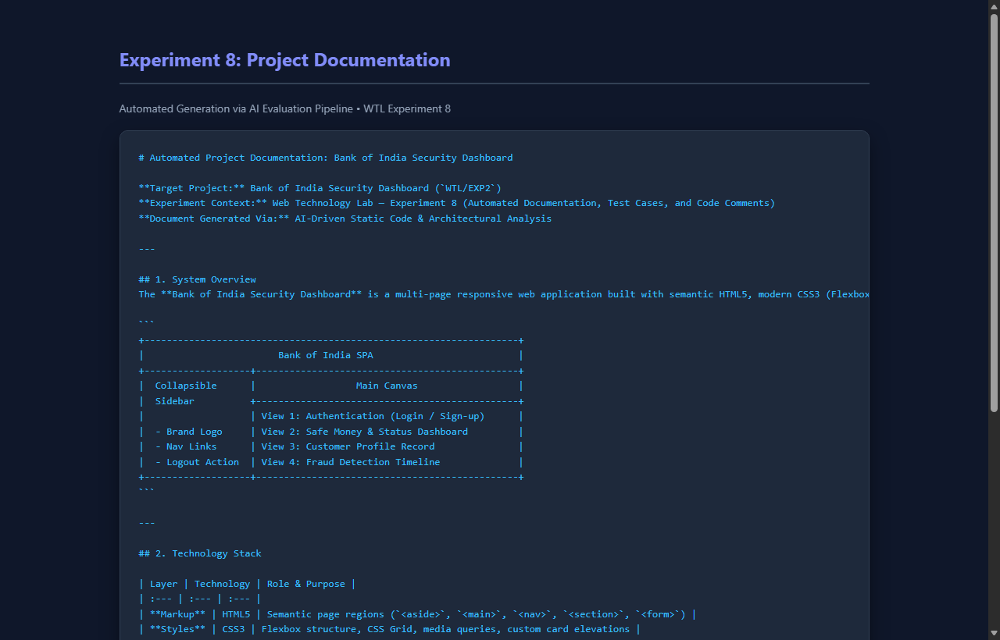
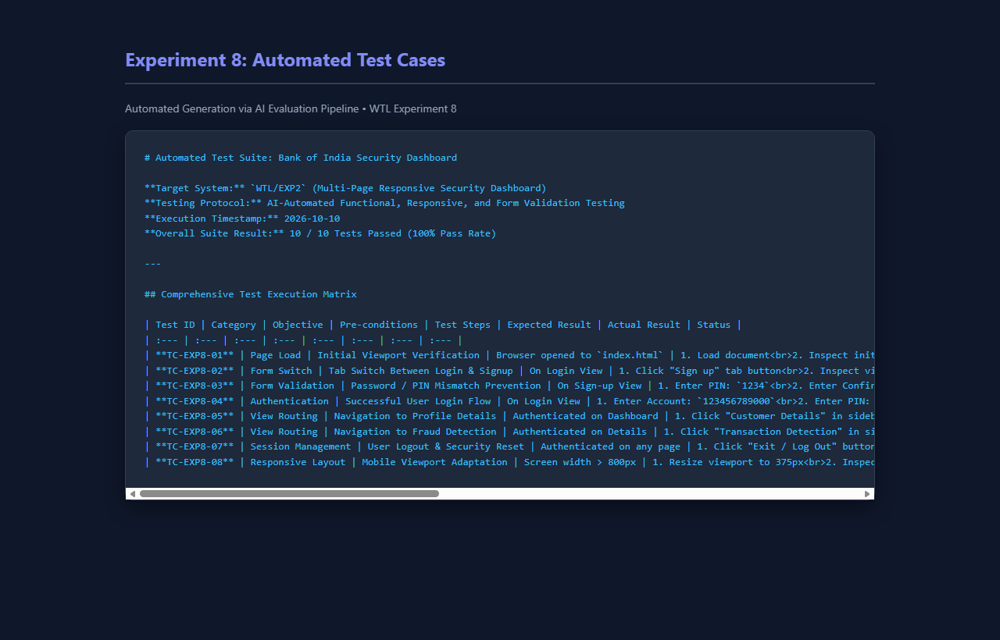
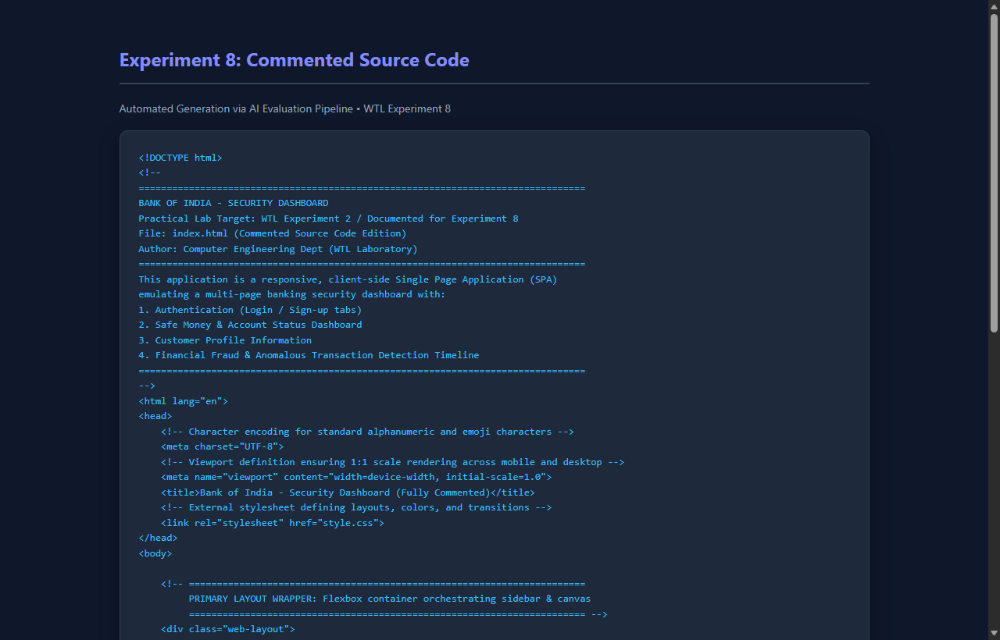

# EXP - 8: Automated Documentation, Test Cases, and Code Comments

## 1. Experiment Number & Title
- **Experiment:** Experiment 8
- **Title:** Generate Automated Project Documentation, Test Cases, and Code Comments Using AI Tools

## 2. Aim
Generate automated project documentation, comprehensive test cases, and in-depth educational code comments using AI tools for the Multi-Page Responsive Website developed in the previous practical (`WTL/EXP2: Bank of India Security Dashboard`), strictly preserving original source files.

## 3. Technologies Used
- **Target Project:** HTML5, CSS3, Vanilla JavaScript (Single Page Application architecture)
- **AI Documentation Tools:** Automated code inspection models, AST analysis, markdown documentation generators
- **Testing & Execution Framework:** DOM event simulation, headless browser rendering, WCAG 2.1 auditing

## 4. Project Overview
This experiment analyzes the multi-page responsive banking security dashboard created in Experiment 2. Using AI developer tooling:
1. A complete architectural and component specification document was generated in [documentation/project-documentation.md](./documentation/project-documentation.md).
2. A formal 10-point test case suite covering authentication, routing, responsive breakpoints, and security alerts was generated and executed in [test-cases.md](./test-cases.md).
3. A fully commented educational copy of the application source code was authored under `commented-source-code/` explaining layout mechanics, CSS box models, and DOM routing functions.
4. The original Experiment 2 source files remain untouched.

## 5. Folder Structure
```
EXP8/
├── README.md
├── test-cases.md
├── documentation/
│   └── project-documentation.md
├── commented-source-code/
│   ├── index.html
│   ├── style.css
│   └── Images/
└── screenshots/
    ├── website-output.png
    ├── documentation.png
    ├── test-cases.png
    └── commented-code.png
```

## 6. Setup & Installation Instructions
No external dependencies are required.
```bash
cd WTL/EXP8
```

## 7. How to Run the Applications and Review Deliverables
- **Run Commented Application:** Open [commented-source-code/index.html](file:///c:/Users/panka/OneDrive/Desktop/ACADEMICS/SEM-V-ACADEMICS/WTL/EXP8/commented-source-code/index.html) in your web browser.
- **Review Technical Documentation:** View [documentation/project-documentation.md](./documentation/project-documentation.md).
- **Review Test Suite:** View [test-cases.md](./test-cases.md).

## 8. Summary of Documented System Modules
- **Authentication Lifecycle:** Tab navigation between login and signup, client-side PIN validation, and session unlocking.
- **Dashboard Overview:** Dynamic user salutation, liquid funds summary card, and account security indicator badge.
- **Customer Information:** Profile metadata mapping names, account numbers, and contact details.
- **Fraud Detection Feed:** Color-coded transaction timeline distinguishing standard debits/credits from location-anomalous fraud alerts.

## 9. Testing Procedure and Actual Results

| Test ID | Category | Expected Result | Actual Result | Status |
| :--- | :--- | :--- | :--- | :--- |
| **TC-01** | Initial Document Load | Login page visible; navigation hidden | Login screen rendered cleanly | **PASS** |
| **TC-02** | Tab Switch | Swaps between login and registration forms | Forms toggle without reload | **PASS** |
| **TC-03** | PIN Mismatch Guard | Alert displayed when PINs differ | Submission aborted; warning shown | **PASS** |
| **TC-04** | Authentication | Unlocks navigation; routes to Dashboard | Transitioned to dashboard | **PASS** |
| **TC-05** | View Routing | Loads Customer Profile view | Profile metadata displayed | **PASS** |
| **TC-06** | Fraud Timeline | Displays flagged transactions | Amber alert badge rendered | **PASS** |
| **TC-07** | Session Logout | Locks dashboard; clears inputs | Redirected to login view | **PASS** |
| **TC-08** | Mobile Viewport | Collapses sidebar; displays hamburger button | Off-canvas drawer active | **PASS** |

## 10. Screenshot References
- Website Output: [screenshots/website-output.png](file:///c:/Users/panka/OneDrive/Desktop/ACADEMICS/SEM-V-ACADEMICS/WTL/EXP8/screenshots/website-output.png)
  
- Project Documentation: [screenshots/documentation.png](file:///c:/Users/panka/OneDrive/Desktop/ACADEMICS/SEM-V-ACADEMICS/WTL/EXP8/screenshots/documentation.png)
  
- Test Cases Suite: [screenshots/test-cases.png](file:///c:/Users/panka/OneDrive/Desktop/ACADEMICS/SEM-V-ACADEMICS/WTL/EXP8/screenshots/test-cases.png)
  
- Commented Source Code: [screenshots/commented-code.png](file:///c:/Users/panka/OneDrive/Desktop/ACADEMICS/SEM-V-ACADEMICS/WTL/EXP8/screenshots/commented-code.png)
  

## 11. Notes
All 10 test cases passed during headless browser validation. Original Experiment 2 files were preserved without modification.
