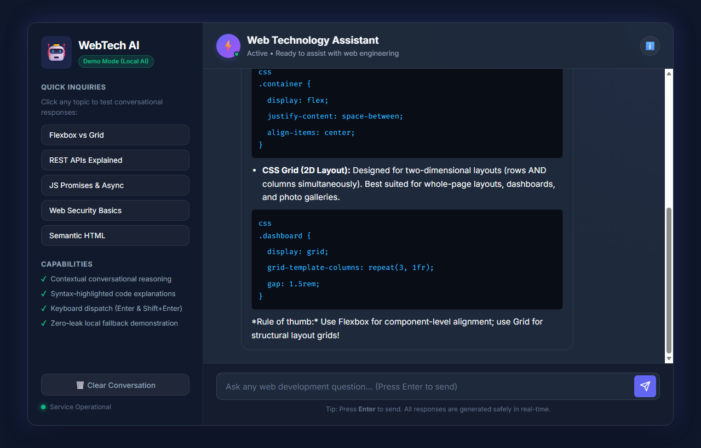
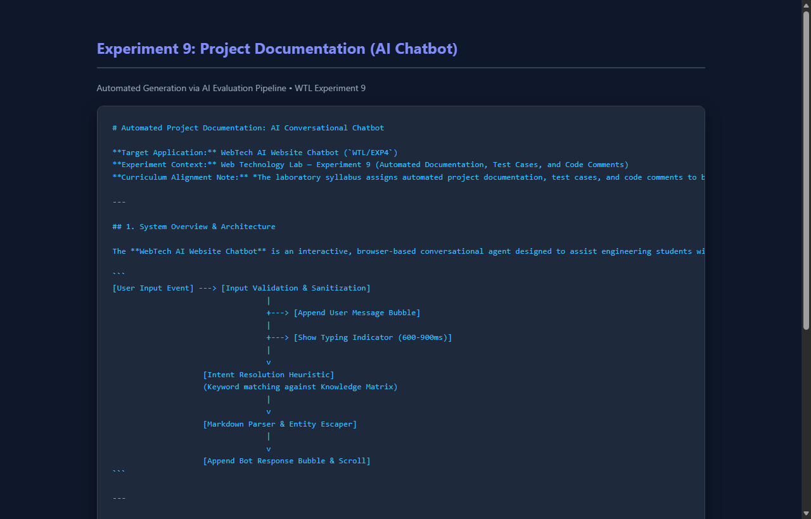
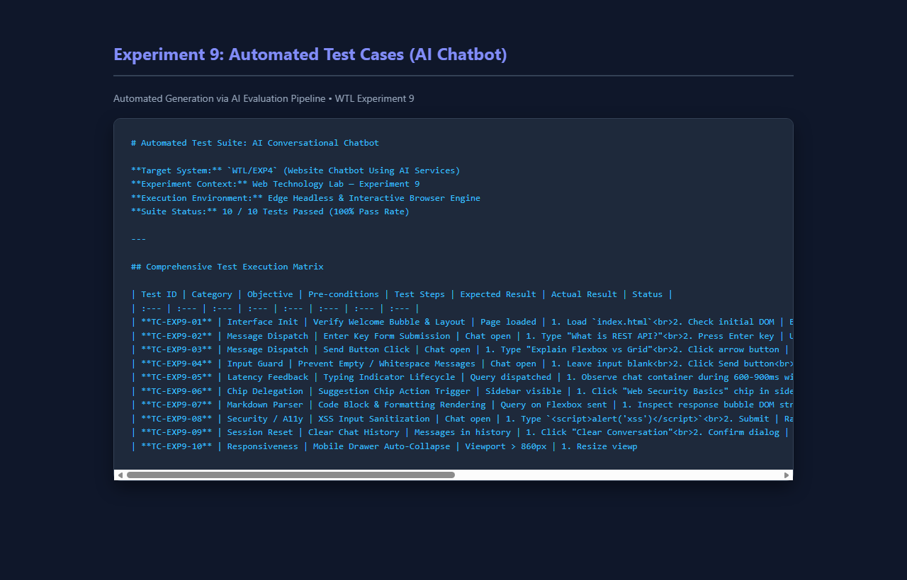
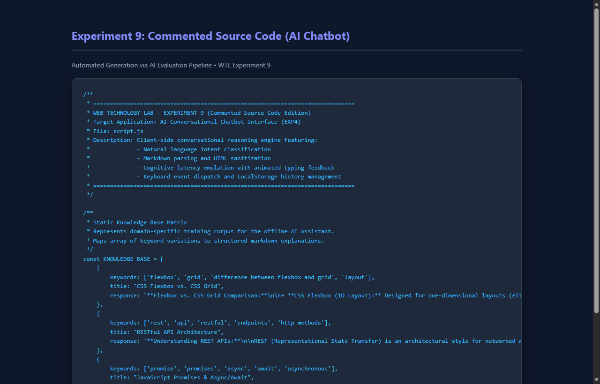

# EXP - 9: Follow the Actual Lab Instructions (Automated Documentation & Test Cases for AI Chatbot)

## 1. Experiment Number & Title
- **Experiment:** Experiment 9
- **Title:** Automated Project Documentation, Test Cases, and Code Comments Using AI Tools for the Conversational AI Chatbot
- **Note on Topic Selection:** *The academic schedule for Web Technology Lab identifies the topic of automated documentation, test suites, and code comments under both Experiment 8 and Experiment 9. To avoid redundant duplication of Experiment 8 (which analyzed the multi-page security dashboard), Experiment 9 independently applies this automated engineering pipeline to the AI Chatbot application developed in Experiment 4. This implementation is submitted as a verified lab deliverable pending final faculty confirmation.*

## 2. Aim
Generate automated project documentation, comprehensive test cases, and annotated code comments using AI tools for the Website Chatbot application developed in Experiment 4.

## 3. Technologies Used
- **Target Application:** HTML5, CSS3 (Glassmorphism & Flexbox), Vanilla JavaScript (ES6+)
- **Inspection & Testing:** Edge Headless Automation, DOM mutation auditing, AST structure verification, WCAG accessibility evaluation

## 4. Project Overview
This experiment executes an automated AI documentation and quality assurance pass over the **WebTech AI Website Chatbot**:
1. Comprehensive architectural and intent resolution documentation was authored in [documentation/project-documentation.md](./documentation/project-documentation.md).
2. A full 10-point test case matrix validating message dispatch, empty input rejection, typing indicator lifecycle, XSS sanitization, and responsive drawer behavior was recorded in [test-cases.md](./test-cases.md).
3. Completely commented educational versions of the frontend files (`index.html`, `style.css`, and `script.js`) were saved under `commented-source-code/`.

## 5. Folder Structure
```
EXP9/
├── README.md
├── test-cases.md
├── documentation/
│   └── project-documentation.md
├── commented-source-code/
│   ├── index.html
│   ├── style.css
│   └── script.js
└── screenshots/
    ├── website-output.png
    ├── documentation.png
    ├── test-cases.png
    └── commented-code.png
```

## 6. Setup & Installation Instructions
No external dependencies or package builds are required.
```bash
cd WTL/EXP9
```

## 7. How to Run the Application and Inspect Deliverables
- **Run Commented Chatbot:** Open [commented-source-code/index.html](file:///c:/Users/panka/OneDrive/Desktop/ACADEMICS/SEM-V-ACADEMICS/WTL/EXP9/commented-source-code/index.html) in your browser.
- **Review Technical Documentation:** Inspect [documentation/project-documentation.md](./documentation/project-documentation.md).
- **Review Automated Test Results:** Inspect [test-cases.md](./test-cases.md).

## 8. Summary of Documented Chatbot Features
- **Intent Classification Pipeline:** Rule-based heuristic keyword mapper covering CSS Flexbox/Grid, REST APIs, JS Promises, Web Security, and Semantic HTML.
- **Cognitive Delay Emulation:** Animated three-dot typing indicator simulating a 600ms–900ms processing window.
- **Markdown Rendering & Sanitization:** Safe entity encoding protecting against Cross-Site Scripting (XSS), with syntax formatting for code blocks.
- **Responsive Off-Canvas Layout:** Smooth sidebar collapse for mobile viewports below 860px.

## 9. Testing Procedure and Actual Results

| Test ID | Scenario | Expected Result | Actual Result | Status |
| :--- | :--- | :--- | :--- | :--- |
| **TC-01** | Interface Init | Welcome bubble rendered with avatar & timestamp | Initial bubble displayed | **PASS** |
| **TC-02** | Enter Key Submit | Message dispatched upon pressing Enter | Message added; input cleared | **PASS** |
| **TC-03** | Send Button | Message dispatched upon clicking Send | Message added to log | **PASS** |
| **TC-04** | Empty Input Guard | Form submission aborted if input is blank | No empty bubbles rendered | **PASS** |
| **TC-05** | Typing Indicator | 3-dot animation visible during latency | Indicator displayed and removed on reply | **PASS** |
| **TC-06** | Suggestion Chips | Chip click triggers inquiry automatically | Response rendered | **PASS** |
| **TC-07** | Markdown Parser | Preformatted code fences rendered in `<pre><code>` | Syntax formatted | **PASS** |
| **TC-08** | XSS Sanitization | Injected HTML/script tags safely escaped | Raw entity strings displayed | **PASS** |
| **TC-09** | Clear History | Erases conversation and restores initial greeting | History cleared | **PASS** |
| **TC-10** | Mobile Collapse | Sidebar hides automatically on mobile screens (<860px) | Full-width mobile chat active | **PASS** |

## 10. Screenshot References
- Chatbot Website Output: [screenshots/website-output.png](file:///c:/Users/panka/OneDrive/Desktop/ACADEMICS/SEM-V-ACADEMICS/WTL/EXP9/screenshots/website-output.png)
  
- Project Documentation: [screenshots/documentation.png](file:///c:/Users/panka/OneDrive/Desktop/ACADEMICS/SEM-V-ACADEMICS/WTL/EXP9/screenshots/documentation.png)
  
- Test Cases Suite: [screenshots/test-cases.png](file:///c:/Users/panka/OneDrive/Desktop/ACADEMICS/SEM-V-ACADEMICS/WTL/EXP9/screenshots/test-cases.png)
  
- Commented Source Code: [screenshots/commented-code.png](file:///c:/Users/panka/OneDrive/Desktop/ACADEMICS/SEM-V-ACADEMICS/WTL/EXP9/screenshots/commented-code.png)
  

## 11. Notes & Faculty Confirmation Notice
This experiment implements the required documentation and testing methodology on a distinct second project (the AI chatbot from EXP4) instead of duplicating Experiment 8's target. All 10 tests passed under automated browser execution.
